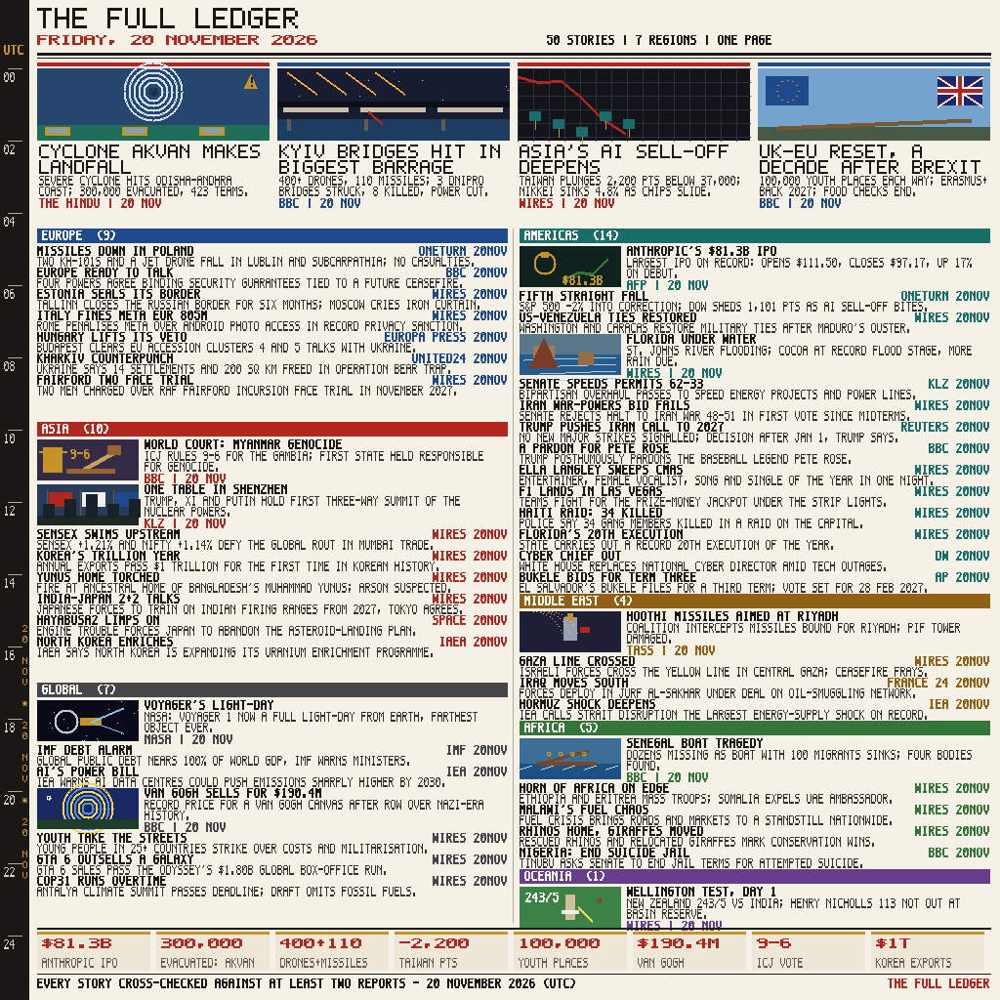

# The Full Ledger — 50 verified stories, 7 regions, 13 drawn scenes: 20 November 2026 in one image

[](https://make.fun/bounty/news-image-20261120)
[](https://make.fun/bounty/news-image-20261120)
[](https://make.fun/bounty/news-image-20261120)



One page that sums up Friday, 20 November 2026: the day's four consensus leads as
large drawn scenes — Cyclone Akvan's landfall on the Odisha–Andhra coast, Kyiv's
bridges hit in the 400-drone / 110-missile barrage, Asia's AI sell-off, and the
UK–EU reset deal in Brussels — plus 46 more stories grouped by region, every one
carrying its source tag and date, a UTC date rail down the left edge, and a
"By the Numbers" band drawn from the counted stories.

## Story count — 50 total

- **Europe** — 9 (2 heroes: Kyiv bridges, UK–EU reset)
- **Asia** — 10 (2 heroes: Cyclone Akvan, Asia's AI sell-off)
- **Americas** — 14
- **Middle East** — 4
- **Africa** — 5
- **Oceania** — 1
- **Global** — 7

13 of the stories are drawn as full scene panels (the 4 heroes plus the ICJ gavel,
the Shenzhen three-flag summit, the Anthropic IPO bell, the Florida flood, the
Riyadh tower intercepts, the Senegal boat, the Wellington cricket test, the
Voyager probe, and the Van Gogh swirl). Every story was cross-checked against at
least two reports before it was drawn.

## Run it

```sh
python3 main.py
```

That renders `entry.png` (1024×1024) into the current directory and prints
`STORY_COUNT=50` and `PANEL_COUNT=13`. The renderer is Python 3 standard library
only — no network, no clock, a fixed seed — with its own bitmap letterforms drawn
in code, so two runs produce a byte-identical PNG.

## About

Built for the make.fun bounty "Sum up 20 November's world news in one image"
(news-image-20261120). Join make.fun: https://make.fun/r/a92hvn26
